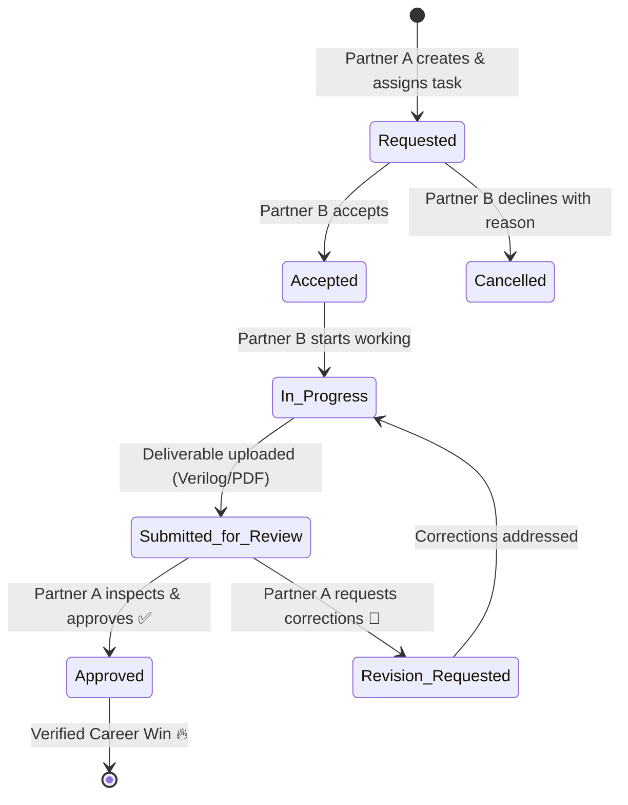

# DuoMate 🚀
> *"Two Friends. One Goal. Better Every Day."*

A private, modern, production-grade career growth, study management, and mutual accountability web platform built exclusively for **Aadhavan** and **MY FRD**.

Both users share high-impact ambitions in:
- **VLSI Design and Verification**
- **AI Hardware Accelerators & Neuromorphic Chip Design**
- **Semiconductor Engineering & Physical Design (ASIC/FPGA)**
- **GATE ECE Preparation**

---

## 🌟 Key Highlights & Philosophy

- **Equal Partnership**: Neither user is an administrator or subordinate. Both users have equal permissions to assign tasks, request work, review submissions, approve deliverables, and track progress.
- **Strict Verification & Review**: Tasks assigned to each other follow a formal state machine (`Requested` → `Accepted` → `In Progress` → `Submitted for Review` → `Approved` or `Revision Requested`). Completion only counts when verified by the partner.
- **Deep Technical Alignment**: Preloaded with the complete 10-subject GATE ECE syllabus and a 7-level progressive VLSI & AI semiconductor curriculum.
- **Dual Mode (Supabase + Local Standby)**: Works with live Supabase PostgreSQL/Auth/Realtime, with a zero-friction local switcher for seamless testing as either partner.

---

## 🛠️ Technology Stack

- **Frontend**: React 19, TypeScript, Vite, Tailwind CSS v4 (`@tailwindcss/vite`), Framer Motion, Lucide Icons, Recharts, Sonner toasts.
- **UI Components**: Custom shadcn/ui-inspired primitives (Card, Button, Dialog, Select, Progress, Tabs, Avatar, Badge, Switch, ScrollArea, etc.).
- **Backend Infrastructure**: Supabase, PostgreSQL 15, Supabase Auth, Supabase Realtime Channels, Supabase Storage, Row Level Security (RLS).
- **Design System**: Dark navy high-contrast theme & clean light mode, Linear/Notion/Discord-inspired sleek aesthetics.

---

## 🧭 Application Modules (17 Navigation Views)

| # | View | Route | Description |
|---|------|-------|-------------|
| 1 | **Dashboard** | `/` | Daily greeting, personalized performance metrics, partner activity, career goal progress & quick actions |
| 2 | **My Tasks** | `/tasks/mine` | All deliverables created by or assigned to you with full lifecycle actions |
| 3 | **Partner Tasks** | `/tasks/partner` | Dedicated view into tasks assigned to your study partner |
| 4 | **Shared Tasks** | `/tasks/shared` | Collaborative mutual deliverables worked on together |
| 5 | **Daily Checklist** | `/checklist` | Today's accountability list with completion gauge and partner's live checklist view |
| 6 | **Career Roadmap** | `/roadmap` | Dual-track executive view comparing GATE ECE & VLSI progress side-by-side |
| 7 | **GATE ECE Prep** | `/gate` | 10 GATE subjects syllabus breakdown, mock test score logger & accuracy tracker |
| 8 | **VLSI + AI Learning** | `/vlsi` | 7-Level roadmap from Digital Fundamentals to custom NPU AI systolic arrays |
| 9 | **Study Timer** | `/timer` | Pomodoro focus timer (25m/5m/15m) with category tag and circular progress ring |
| 10 | **Study Together** | `/study-together` | Real-time presence mode to join partner's active study session |
| 11 | **Private Chat** | `/chat` | 4 Dedicated discussion channels (General, Study, Tasks, Career) with emoji reactions |
| 12 | **Activity Timeline** | `/activity` | Transparent chronologically audited feed of workspace actions |
| 13 | **Analytics** | `/analytics` | Recharts bar & pie charts, study hours comparison & productivity scoring |
| 14 | **Calendar** | `/calendar` | Interactive monthly calendar displaying task deadlines and study blocks |
| 15 | **Resource Library** | `/resources` | Central repository for Verilog code, testbenches, lecture PDFs & reference links |
| 16 | **Weekly Reports** | `/reports` | Formatted weekly digest with export/print capability for mutual review |
| 17 | **Settings** | `/settings` | Profile editor, theme toggle, workspace ID sharing & Supabase connection monitor |

---

## 🗄️ Database Architecture (26 Supabase Tables)

The complete SQL migration script is located at:
`supabase/migrations/20240101000000_duomate_schema.sql`

Tables defined:
1. `workspaces` — Shared private workspace
2. `profiles` — User identity, online presence, bio, avatar
3. `workspace_members` — Equal partner workspace mapping
4. `tasks` — Deliverables with priorities, deadlines, deliverables, review requirements
5. `task_comments` — Real-time per-task discussion thread
6. `task_attachments` — Uploaded code, testbenches & simulation screenshots
7. `task_status_history` — Audit trail for every state transition
8. `checklists` — Daily accountability headers
9. `checklist_items` — Checkbox targets with completion timestamps
10. `checklist_templates` — Recurring daily templates
11. `messages` — Chat stream partitioned by 4 topic channels
12. `study_sessions` — Focus timer records with duration & notes
13. `shared_study_sessions` — Study-together sessions
14. `daily_goals` — Daily targets for GATE questions & study hours
15. `weekly_goals` — Weekly objectives & learning milestones
16. `career_tracks` — Track definitions (GATE & VLSI)
17. `career_subjects` — Subject catalog with official GATE weightages
18. `career_topics` — Hierarchical topics and competencies
19. `user_topic_progress` — Status per user (not_started, in_progress, completed, revision)
20. `career_milestones` — Major technical milestones
21. `activity_logs` — Event-sourced activity timeline
22. `notifications` — In-app alerts for assignments and approvals
23. `gate_mock_tests` — Full-length and subject test results
24. `gate_mock_test_results` — Detailed question breakdown
25. `learning_resources` — Library links and documents
26. `weekly_reports` — Historical snapshots of weekly accomplishments

---

## 🚀 Quick Start Guide

### 1. Install Dependencies
```bash
npm install
```

### 2. Configure Environment Variables
Copy `.env.example` to `.env.local`:
```bash
cp .env.example .env.local
```
Update with your Supabase project credentials:
```env
VITE_SUPABASE_URL=https://your-project.supabase.co
VITE_SUPABASE_ANON_KEY=your-anon-key-here
```
*(If credentials are not yet configured, DuoMate automatically runs in Standby Mode with the built-in partner switcher).*

### 3. Deploy Database Schema
1. Open your Supabase Dashboard → **SQL Editor**.
2. Paste the contents of `supabase/migrations/20240101000000_duomate_schema.sql`.
3. Click **Run**. All 26 tables, foreign keys, triggers, and Row Level Security policies will be configured.

### 4. Run Development Server
```bash
npm run dev
```
Open [http://localhost:5173](http://localhost:5173) in your browser.

### 5. Build for Production
```bash
npm run build
npm run preview
```

---

## 🤝 Partner Review & Accountability Flow



---

## 🛡️ Security & Privacy
- Row Level Security (RLS) guarantees that only authenticated members of the private workspace can view or interact with tasks, messages, checklists and mock test scores.
- Zero public data leaks.
- Client-side role validation backed by PostgreSQL security policies.
